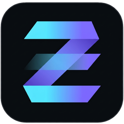
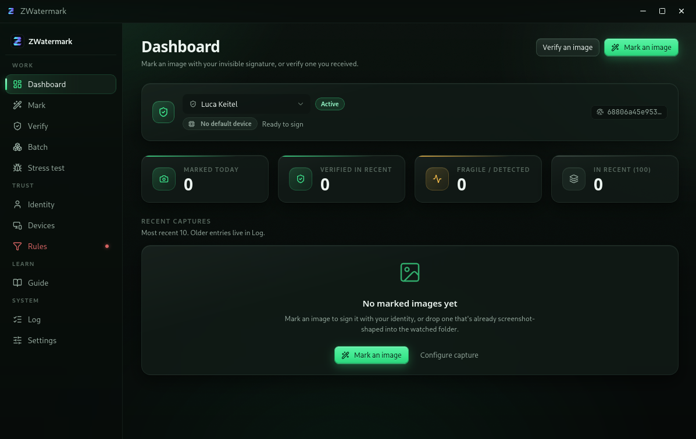

<div align="center">



# ZWatermark

**Every screenshot, invisibly signed with your cryptographic identity.**

A local-first desktop app that embeds a signed, steganographic watermark into every image you mark — so if the file leaks, is reposted, or is impersonated, anyone can prove where it came from and when.

<sub>Ed25519 · BLAKE3 · DWT spread-spectrum · Pixel-LSB signature · RFC 3161 · OpenTimestamps · Tauri 2 · Rust · React 19</sub>

<br />

<a href="https://zsync.eu/zwatermark/"></a>
<a href="https://github.com/TheHolyOneZ/ZWatermark"></a>
<a href="LICENSE"></a>


<br /><br />



</div>

---

## Why

Visible watermarks get cropped off in three seconds. EXIF metadata gets stripped by any re-save. Netflix-tier forensic watermarking exists — but only for enterprise studios.

ZWatermark closes that gap for individuals and small teams:

- **Journalists & sources** — trace which reporter's laptop a leaked screenshot came from without watermarks visible to the source.
- **Digital artists & creators** — prove your art is yours before someone reposts it under their name.
- **Pentesters & security consultants** — provable origin for engagement screenshots.
- **Insider-threat / IR teams** — automatic marking, offline verification, CSV incident reports.
- **Anyone who ships screenshots to strangers** — a cryptographic receipt that this really came from you.

Free. Offline by default. Open source. GPL-3.0-or-later.

---

## What it actually does

Every mark writes **two independent layers** into your image and (optionally) attaches a sidecar of external time proofs:

<table>
<tr>
<td width="33%" valign="top">

### 

<sub>DWT spread-spectrum</sub>

Payload hides in the mid-frequency HL2 / LH2 subbands of a 2-level Discrete Wavelet Transform. Survives screenshotting, JPEG re-encoding, resizing, phone-photo-of-monitor.

**Proves origin** after the file travels the internet.

</td>
<td width="33%" valign="top">

### 

<sub>Ed25519-signed LSB</sub>

Full 32-byte Ed25519 public key + 64-byte signature embedded in the least-significant bits. Any pixel-level edit breaks the signature.

**Proves the file bytes haven't been touched** since you signed them.

</td>
<td width="33%" valign="top">

### 

<sub><code>image.png.zwm</code></sub>

Bincode-serialized bundle with SHA-256 of the marked image, pubkey, and cryptographic time proofs from RFC 3161 TSAs + OpenTimestamps Bitcoin anchors.

**Proves *when* you signed** it — no one, not even you, can backdate.

</td>
</tr>
</table>

---

## Under the hood

<table>
<tr>
<td>

**Signing** &nbsp;&nbsp;&nbsp;

</td>
<td>Ed25519 — 32-byte pubkey, 64-byte signature, deterministic nonces (RFC 8032). Same primitive used by OpenSSH, Signal, Tor v3, WireGuard, GitHub SSH.</td>
</tr>
<tr>
<td>

**Hashing** &nbsp;&nbsp;&nbsp;

</td>
<td>BLAKE3 — 6–10× faster than SHA-256, Merkle-tree design, used for the image digest and the payload envelope.</td>
</tr>
<tr>
<td>

**Robust layer** &nbsp;&nbsp;&nbsp;

</td>
<td>DWT spread-spectrum embed in HL2 &amp; LH2 subbands. Carries a 128-bit fingerprint (identity + device + timestamp + counter). Based on Cox/Kilian/Leighton/Shamoon 1997.</td>
</tr>
<tr>
<td>

**Fragile layer** &nbsp;&nbsp;&nbsp;

</td>
<td>1 bit per color channel per pixel LSB. Carries the full pubkey, exact signing time, optional screen serial, and the Ed25519 signature covering the entire image plus payload.</td>
</tr>
<tr>
<td>

**Timestamps** &nbsp;&nbsp;&nbsp;

</td>
<td>RFC 3161 TSA tokens (FreeTSA, DigiCert by default) + OpenTimestamps calendars (Alice, Bob, Finney). Only the SHA-256 hash is sent — no pixels, no identity.</td>
</tr>
<tr>
<td>

**Sidecar** &nbsp;&nbsp;&nbsp;

</td>
<td><code>image.png.zwm</code> — bincode-serialized <code>SidecarV1</code> containing digest, pubkey, creation epoch, RFC 3161 DER tokens and OTS receipt bytes. Verified offline (plus a Bitcoin-header lookup for OTS).</td>
</tr>
</table>

---

## How it works, in plain English

Skip this section if you already speak crypto. Read on if you want to understand what's happening under the hood without a computer science degree.

### Your identity is a pair of secret math numbers

When you create an identity in ZWatermark, the app generates a matched pair of very large numbers — a **private key** (that stays on your machine, forever) and a **public key** (that anyone is allowed to see). The math connecting them has one useful property: you can use the private key to produce a *signature* over any file, and anyone with the public key can check that signature came from you — but they cannot use the public key to figure out the private key or forge new signatures.

We use a signing scheme called **Ed25519**. It's the same one behind SSH logins, Signal messages, Tor onion services, WireGuard tunnels, and every commit signed on GitHub. It's fast, small (32-byte public key, 64-byte signature), and considered secure against everything short of a working quantum computer.

Your private key never leaves your device. Not to us, not to a cloud, not to a server. If you back it up, you back it up yourself.

### Marking an image is really two watermarks in one

When you press **Mark**, ZWatermark writes *two independent watermarks* into your image at the same time:

- **The Robust watermark** hides tiny changes across the *frequency structure* of the image — think of it like fingerprint powder dusted through the whole picture rather than written on top of it. It's invisible to the eye. It survives being screenshotted again, JPEG-recompressed, resized, even photographed off a monitor with a phone. What it carries is a short fingerprint of your identity, your device, and roughly when you signed it.

- **The Fragile watermark** writes a *cryptographic signature* into the least noticeable bit of every pixel. This one is a digital seal: it stays valid only if nobody has touched the file. Change a single pixel and the seal breaks. That's the point — it's how a verifier can say with certainty that "this file, byte for byte, is the one you signed."

You choose which layer (or both) with the **Strength** picker. **Both** is the recommended default: it proves origin *and* flags tampering.

### Verifying doesn't require any accounts or downloads

Anyone with the app (or the CLI, or eventually the browser verifier) can open a marked image and get an answer instantly, offline. The verifier reads out your public key from inside the image, checks the signature, and shows the result — a green banner if the signature holds, a warning if it doesn't. If they already have your identity in their local keyring, they see your name. If they don't, they see just the key's fingerprint.

That's the honest limit of any watermarking system: it can prove a file came from a specific *key*, but linking that key to your *name* still depends on you publishing your fingerprint somewhere trustworthy (your website, GitHub profile, Nostr, or eventually the built-in registry).

### The `.zwm` sidecar answers "when?"

A signature proves *who* signed a file. It does not prove *when*. Without proof of time, a thief could strip your mark, re-mark the same image with their own key, and claim they were first.

That's what the optional `.zwm` sidecar is for. When timestamping is turned on, ZWatermark asks two independent **Time Stamp Authorities** (small servers whose only job is signing "yes, we saw this hash at this exact moment") to stamp the SHA-256 hash of your marked image. Their responses are archived in the sidecar file next to your image.

Then it goes further: it also submits the same hash to **OpenTimestamps**, which folds thousands of submitted hashes into a Merkle tree and publishes the tree's root into a **Bitcoin block**. About a day later, your image's existence is provably anchored to a moment in Bitcoin's history — a timeline no one can rewrite without redoing years of mining, which no one can afford.

Only the hash is sent. No pixels, no metadata, no identity information is transmitted.

### The whole point: nothing leaves your machine unless you say so

ZWatermark runs entirely on your computer. It doesn't phone home, doesn't gather analytics, doesn't need an account, doesn't upload your images. The only outbound network traffic happens when *you* click something that needs it: pressing **Publish identity** (planned), or leaving **timestamps** turned on (in which case only the file's hash goes to the TSAs you configured).

That's why the whole project is open source under GPL-3.0 — so anyone can read the code and confirm exactly what's leaving their machine.

---

## The app, tab by tab

| Tab | What it does |
| :-- | :-- |
| **Dashboard** | Identity hero, quick actions, recent captures. |
| **Mark** | Drop an image → sign with your active identity. Pick strength (Robust / Fragile / Both / Max), device, optional visible overlay, optional timestamps. Writes `name.zw.png` next to the source; original is untouched. |
| **Verify** | Extracts the robust + fragile payloads, checks the Ed25519 signature against the embedded pubkey, looks up the signer in your keyring, and validates any `.zwm` sidecar's timestamps against the TSA certificates and Bitcoin block headers. |
| **Batch** | Mark or verify entire folders. Verify emits a CSV incident report. Runs in the background with a progress strip. |
| **Stress Test** | Fires synthetic attacks at a marked image (JPEG re-encode at Q40, rescale ±30 %, crop, gaussian, etc.) so you see empirically how much your chosen strength survives. |
| **Identity** | Create, name, export, import identities. One active identity signs your marks. The Publish button is wired and calls the registry API, but the backend at `registry.zsync.eu` is not yet deployed — publish your fingerprint out-of-band until it lands. |
| **Devices** | Optional labels (workstation, laptop, camera, phone, custom) that ride alongside your key, so verifiers can tell "Alice on studio Mac" from "Alice on phone". |
| **Log** | Local event stream: captures picked up, marks written, verifies done. |
| **Settings** | Capture folders, default strength, default overlay, TSA & OTS URLs, launch-vault password, About. |
| **Rules** | *Planned.* Folder allow/deny, per-folder strength, work-hours window. UI ships today; the auto-marking pipeline that would consume the rules is not wired yet. |
| **Guide** | The full 10-chapter in-app manual — everything below plus deep dives. |

---

## Strength modes

| Mode | Layers | Survives | Cost | Use when |
| :-- | :-- | :-- | :-- | :-- |
| **Robust** | DWT only | Recompression, resizing, phone-photo | Tiny | You only need proof of *origin*. |
| **Fragile** | Signed LSB only | Nothing — any edit breaks it | Tiny | You need proof the *bytes* are untouched. |
| **Both** ★ | DWT + Signed LSB | Origin survives; tamper-flag on any edit | Small | Recommended for almost everyone. |
| **Max** | DWT + Signed LSB, boosted amplitude | Aggressive re-encoding, 2× rescale, adversarial workflows | Slight visible noise at zoom | Anything you distribute widely. |

### Can you see the difference?

Below is the same 1600 × 1067 image marked at every strength — plus the untouched original. All four marked versions carry a cryptographically-signed watermark that a verifier can extract. To the human eye, they should look identical to the original. That's the whole point of a *steganographic* watermark: if you can see it, it's not a steganographic watermark anymore.

<table>
<tr>
<td align="center" width="20%"><b>Original</b><br /><sub>unmarked</sub></td>
<td align="center" width="20%"><b>Robust</b><br /><sub>DWT only</sub></td>
<td align="center" width="20%"><b>Fragile</b><br /><sub>Signed LSB only</sub></td>
<td align="center" width="20%"><b>Both</b> ★<br /><sub>recommended</sub></td>
<td align="center" width="20%"><b>Max</b><br /><sub>boosted DWT</sub></td>
</tr>
<tr>
<td></td>
<td></td>
<td></td>
<td></td>
<td></td>
</tr>
</table>

<sub>Photo: Preikestolen, Norway. Source: <a href="https://picsum.photos/id/1015/1600/1067">Picsum Photos</a> — Unsplash licence, free commercial use. Full-resolution PNGs in <a href="demo/"><code>demo/</code></a>. Open the raw files in any image viewer and flip between them to convince yourself.</sub>

The differences are extractable to a verifier and invisible to you. If you zoom to 400 % on flat regions (the sky, calm water) in **Max** and stare hard, you may notice a faint dithering pattern — that's the price of the extra robustness. **Both** costs practically nothing perceptually and is the recommended default.

---

## What survives, what doesn't

| Transformation | Robust | Fragile |
| :-- | :-: | :-: |
| Crop to 25 % or larger | ✅ | ❌ |
| JPEG re-save at Q40+ | ✅ | ❌ |
| Rescale ±30 % | ✅ | ❌ |
| Phone photo of the monitor | ✅ | ❌ |
| Print → scan | ✅ | ❌ |
| Discord / Slack / WhatsApp re-share | ✅ | ❌ |
| Minor color / brightness / contrast tweaks | ✅ | ❌ |
| Byte-identical file | ✅ | ✅ |
| Extreme downscale (<200 px) | ❌ | ❌ |
| Heavy Gaussian blur / adversarial denoising | ❌ | ❌ |
| Full diffusion img2img regeneration | ❌ | ❌ |
| Redraw / trace / retype | ❌ | ❌ |

Honest failure modes are surfaced in-app. No fake certainty.

---

## Defending against identity theft

An adversary can strip your mark, re-encode aggressively, and re-mark with *their* key — cryptography alone cannot stop this. The defense is time-based:

1. **Publish your key fingerprint out-of-band** — your website, bio, GitHub profile, Nostr pubkey field. (An in-app registry at `registry.zsync.eu` is planned but not yet live.)
2. **Always mark with timestamps ON.** The external time anchor is what makes your priority claim real.
3. **Publish immediately** to somewhere with its own timestamps: your site, Mastodon, Nostr, IPFS.
4. **Ship the `.zwm` sidecar** alongside every copy. Without it, the timestamp proofs are lost.
5. **Use Both or Max** for anything distributed widely. Aggressive stripping leaves visible damage — evidence of tampering.

The courtroom story you're building:

> "Here is my key, published on 2026-06-01. Here is my image, signed with that key and timestamped by three independent TSAs and the Bitcoin blockchain on 2026-07-04 at 14:22 UTC. Here is the alleged thief's version, signed by a different key, timestamped on 2026-07-05. Their claim of priority is arithmetically impossible."

---

## How it compares

| System | Cryptographic identity | Pixel-embedded (survives re-encoding) | External time proof | Verifiable offline | Open source |
| :-- | :-: | :-: | :-: | :-: | :-: |
| **ZWatermark** | ✅ Ed25519 | ✅ DWT + LSB | ✅ RFC 3161 + Bitcoin | ✅ | ✅ (GPL-3.0) |
| [C2PA / Content Credentials](https://c2pa.org/) | ✅ X.509 | ❌ Metadata sidecar only | ⚠️ Optional TSA | ✅ | ✅ |
| IPTC / XMP metadata | ❌ | ❌ Metadata only | ❌ | ✅ | ✅ |
| Google SynthID | ❌ No identity | ✅ Neural pixel embed | ❌ | ❌ Closed-source detector | ❌ |
| Adobe Content Authenticity | ✅ X.509 | ❌ Metadata sidecar | ⚠️ Optional | ⚠️ Requires SDK | ⚠️ Spec open, some tooling proprietary |

ZWatermark is the only one on this list that combines a signed pixel-level watermark with independent external time anchoring — while being fully open, fully offline-verifiable, and free.

---

## Building from source

Requires **Node 20+**, **pnpm 10+**, and a working **Rust** toolchain (stable, edition 2021).

```bash
git clone https://github.com/TheHolyOneZ/ZWatermark.git
cd ZWatermark

pnpm install
pnpm tauri dev                          # run the desktop app
cargo test --workspace                  # run the Rust test suite
cargo run -p zwatermark-cli -- --help   # try the CLI
```

Pre-built binaries live at [github.com/TheHolyOneZ/ZWatermark/releases](https://github.com/TheHolyOneZ/ZWatermark/releases).

---

## Threat model — read this before you rely on it

ZWatermark **raises the bar** of leaking from seconds to hours of skilled work and **makes casual re-sharing traceable**. It does not, and cannot, defeat:

- A dedicated forensic team specifically targeting the watermark.
- Full regeneration of the image via a diffusion model.
- A hand-redraw or retype of the underlying content.

Watermarking a screenshot proves the origin of the *capture*, not the *authorship of the content*. Some jurisdictions require disclosure when watermarking employee devices — an opt-in visible-overlay mode is provided for compliance.

---

## Status & roadmap

Pre-release. Core mark / verify / timestamp path is stable and passes all unit + integration tests. Publishing to the identity registry is planned; the Rules tab is UI-only until the auto-marking pipeline lands.

- [x] **M1** — Core encoder / decoder library (`crates/zwatermark-core`)
- [x] **M2** — Tauri desktop app (Mark, Verify, Batch, Identity, Devices, Settings, Guide)
- [x] **M3** — Embedded pubkey + RFC 3161 + OpenTimestamps sidecar
- [ ] **M4** — CLI parity with the desktop app (`zwatermark-cli`)
- [ ] **M5** — Per-OS screenshot interception + auto-marking pipeline (wires up the Rules tab)
- [ ] **M6** — Identity registry backend at `registry.zsync.eu`

---

## License

GPL-3.0-or-later. See [`LICENSE`](LICENSE).

Copyright © 2026 [TheHolyOneZ](https://github.com/TheHolyOneZ).

Because the whole point is that anyone can verify your marks — the code that does the verifying has to be open and stay open.

---

<div align="center">

<sub>Built by <a href="https://github.com/TheHolyOneZ">TheHolyOneZ</a> · Part of the <a href="https://zsync.eu">Z-stack</a> family of security tools · <a href="https://zsync.eu/zwatermark/">zsync.eu/zwatermark</a></sub>

</div>
